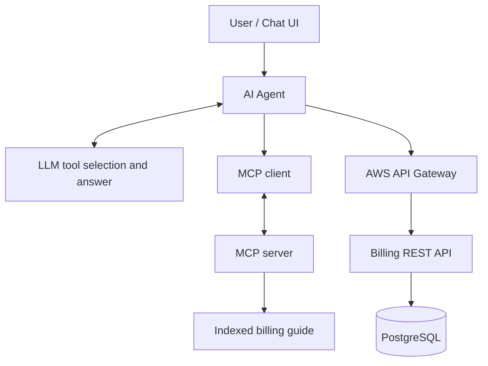
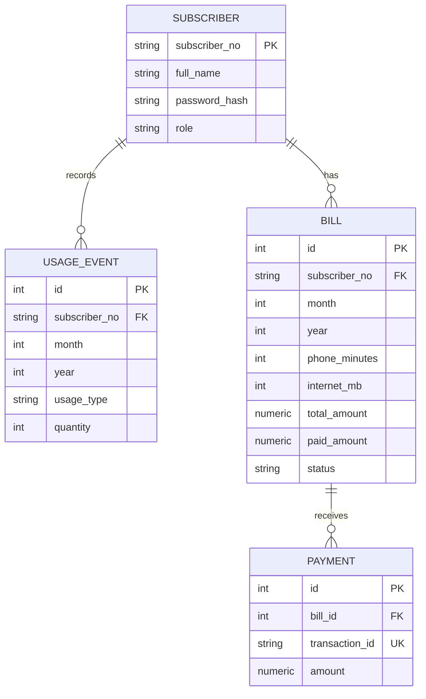

# SE4458 Midterm — Group 2, AI Billing Support Assistant

Conversational assistant for a fictitious mobile provider. The subscriber asks about billing rules, usage, and payments. An LLM chooses tools. The agent executes them. Policy answers come from an MCP server. Live bills and payments come from REST APIs through an API gateway.

This repository is individual coursework. Group 2 is the assigned topic, not a shared submission.

## Architecture



The LLM never calls the database or the gateway itself. The agent does.

| Piece | Where it runs |
| --- | --- |
| Chat UI | http://localhost:8080, or http://3.123.72.226:8080 on the EC2 |
| API Gateway | AWS HTTP API invoke URL, set as `GATEWAY_BASE_URL` |
| Billing API, debug only | http://localhost:18000 |
| Swagger | `<GATEWAY_BASE_URL>/docs` after the gateway is attached |
| MCP server | http://localhost:8002/mcp. This path does not go through the gateway. |
| MCP health | http://localhost:8002/health |
| PostgreSQL | localhost:5433, database `billing`, user/password `billing` |

## Run it

Docker Desktop must be running.

```bash
cp .env.example .env
# Put a real key in .env if you want the chat to answer.
# OPENAI_API_KEY=...
# Any OpenAI-compatible endpoint works:
# OPENAI_BASE_URL=https://api.openai.com/v1
# OPENAI_MODEL=gpt-4o-mini
# On the EC2, point the agent at API Gateway:
# GATEWAY_BASE_URL=https://<api-id>.execute-api.eu-central-1.amazonaws.com

docker compose up --build
```

Open http://localhost:8080 and sign in as `5551001` / `demo123`.

`gpt-4o-mini` is the low-cost default. A short demo is a handful of requests. Without `OPENAI_API_KEY` the REST API, gateway, MCP server, and tests still run. The chat returns a clear error instead of guessing from keywords.

Reset the database and the demo bills:

```bash
docker compose down -v
```

## Demo accounts

| Subscriber | Password | Role | Seeded bills |
| --- | --- | --- | --- |
| 5551001 | demo123 | SUBSCRIBER | One bill every month from Dec 2023 through Nov 2026 (36 months). Sep 2025 paid $50. Oct 2025 unpaid $70. Nov 2026, the current month, unpaid. Older months are paid in full. |
| 5551002 | demo123 | SUBSCRIBER | The same 36 months. Apr 2025 partial: total $70, paid $20, remaining $50. Nov 2026 unpaid. Older months are paid in full. |
| 5551999 | admin123 | ADMIN | Can operate on any subscriber. The chat still binds an admin to their own token. No usage of its own. |

October 2025 for 5551001 is the combined scenario: 800 phone minutes and 35,000 MB (35 GB). Phone is inside the free 1,000 minutes ($0). Internet is $50 plus two extra 10 GB blocks ($20), so $70.

September 2025 is 400 minutes and 8 GB, so the internet plan only: $50, paid by transaction `SEED-5551001-2025-09`.

## Three agent scenarios

Ask these after signing in as 5551001. The screen shows the tool trace.

1. MCP only: `How much does extra internet cost?`  
   Tool: `search_billing_documentation`. Expected sections: **8.1** and **3.2**. 35 GB in section 3.2 is $70.
2. REST only: `What is my October bill?`  
   Tool: `query_bill` through the gateway. Expected: total $70, paid $0, remaining $70, status `UNPAID`. The year defaults to 2025 when the user omits it.
3. Both: `Why is my October bill higher than September?`  
   Tools: `query_bill_detailed` and `search_billing_documentation`. October internet is 35 GB / $70. September is 8 GB / $50. The difference is two extra data blocks from section 3.2. Phone is still free in both months.
4. Payment: `Pay my October bill`, then reply `CONFIRM`.  
   The first turn may only prepare the payment. Nothing is recorded until the latest user message says `CONFIRM` (or `onaylıyorum`). The pay call goes through the gateway and rejects a duplicate transaction ID.

The assistant cannot pass a subscriber number to a tool. A question that names another subscriber is refused for private data. `query_bill` on the public API is a separate mobile-app operation and does not require a token; the agent does not use a number taken from the prompt.

## MCP indexing

Document: `mcp-server/docs/Mobile_Provider_Billing_Guide.md`.

The server is the official MCP Python SDK (`mcp` 2.3, `MCPServer`) on Streamable HTTP at `/mcp`. The tool name is `search_billing_documentation(query)`.

At process start the guide is split on markdown headings. Each chunk keeps its section number, heading, and body. Later queries only score that index. They do not rebuild it. Scoring is case-insensitive full text: word matches in the body, a higher weight on the title, and a bonus when the query phrase appears. Embeddings are not used. The top three excerpts are returned as JSON with the document id, section id, heading, and text.

Three retrieval checks, also covered by `mcp-server/tests/test_indexer.py`:

| Query | Section |
| --- | --- |
| How much does extra internet cost? | 8.1 and 3.2 Additional internet blocks. 35 GB is $70. |
| partial payment | 5.1 Full and partial payments |
| late payment | 6.2 Late payment reminder. The reminder does not add a fee. |

The indexed file is the instructor document `MOB-BILLING-2026-01`. A match includes the document id `Mobile_Provider_Billing_Guide.md`, the section id, the heading, and the excerpt.

```bash
curl -s http://localhost:8002/health
```

## REST API

All operations are under `/api/v1`. A later incompatible contract would be `/api/v2`. Swagger and the OpenAPI document are served by the API and through the gateway.

| Operation | Method and path | Auth | Paging |
| --- | --- | --- | --- |
| Login | `POST /api/v1/auth/login` | No | No |
| Add Usage | `POST /api/v1/usage` | JWT | No |
| Calculate Bill | `POST /api/v1/bills/calculate` | JWT | No |
| Query Bill | `GET /api/v1/bills` | No | No |
| Query Bill Detailed | `GET /api/v1/bills/detailed` | JWT | Yes (`page`, `pageSize`) |
| Pay Bill | `POST /api/v1/bills/pay` | JWT | No |

`Add Usage` records exactly 10 phone minutes or 1 MB of internet. `PHONE` and `INTERNET` are the only usage types.

JSON fields use camelCase (`subscriberNo`, `usageType`, `transactionId`, `pageSize`).

### Pricing assumptions

- Currency is USD. No card is charged.
- 1 GB = 1,000 MB.
- Phone: the first 1,000 minutes are free. Each started 1,000-minute block after that is $10. 1,000 minutes is $0, 1,001 is $10, 2,000 is $10, 2,001 is $20.
- Internet: $50 covers 0 through 20 GB, including a month with no traffic. Each started extra 10 GB block is $10. 20,000 MB is $50, 20,001 MB is $60, 35,000 MB is $70.
- The illustrative "$75" figure in the assignment cannot be produced by these block prices. Seed data uses the formula instead.
- A bill is a snapshot. Usage added after `Calculate Bill` is ignored until `Calculate Bill` runs again.
- Recalculation keeps payments. It is rejected when the new total would fall below the amount already paid.
- Status is `UNPAID`, `PARTIAL`, or `PAID`.
- `paidAmount` on a payment response is the cumulative amount. `amountApplied` is that transaction.
- Duplicate `transactionId` values are rejected with 409, including the same payload sent twice.
- An amount above the remaining balance, or with more than two decimal places, is rejected.
- A subscriber JWT can only read or change that subscriber. Admin can name any subscriber. The chat UI does not expose the admin bypass: its tools have no subscriber argument.
- The Group 1 rule of three tuition queries per student per day is not part of this billing contract, so it is not implemented. The public query is still rate-limited at the gateway.

Seed usage rows may contain more than 10 minutes or 1 MB. They are historical totals loaded so the demo does not insert 35,000 one-megabyte rows. The live `Add Usage` operation never writes any other quantity.

### Errors

| Situation | Status |
| --- | --- |
| Missing or invalid JWT on a protected route | 401 |
| Subscriber touches another subscriber | 403 |
| Unknown subscriber, or bill not calculated | 404 |
| Bad usage type, overpayment, nothing left to pay, too many decimals | 400 |
| Duplicate transaction ID, or recalculated total below payments | 409 |
| Failed validation (month, amount, body) | 422 |

## API Gateway

AWS HTTP API in `eu-central-1`. Every REST operation used by the agent is routed here. The MCP path stays on the MCP server and does not go through this gateway.

The agent reads `GATEWAY_BASE_URL`. On the EC2 that value is the API Gateway invoke URL, for example `https://<api-id>.execute-api.eu-central-1.amazonaws.com`. If the variable is unset, Compose falls back to `http://billing-api:8000` so the stack still starts before the gateway exists. Graded calls use the invoke URL.

Point the gateway integration at the billing API on port 18000 through a VPC Link and an internal load balancer. Leave 18000 closed to the public internet.

| Route | Gateway control |
| --- | --- |
| `GET /health`, `/docs`, `/openapi.json`, `/redoc` | none |
| `POST /api/v1/auth/login` | none |
| `GET /api/v1/bills` | throttle 60 requests per minute |
| `GET /api/v1/bills/detailed` | Lambda authorizer, JWT |
| `POST /api/v1/bills/calculate` | Lambda authorizer, JWT |
| `POST /api/v1/bills/pay` | Lambda authorizer, JWT |
| `POST /api/v1/usage` | Lambda authorizer, JWT |

The authorizer source is `gateway/authorizer.py`. It is one file, standard library only. Create a Python 3.12 Lambda from it, payload format 2.0, simple responses enabled. Set `JWT_SECRET` to `billing-demo-secret-key-please-change` and `JWT_ISSUER` to `billing-key`. That is the same HS256 secret the API uses to sign tokens. Tokens expire after 8 hours. A missing or invalid token returns `{"isAuthorized": false}`, which API Gateway turns into 401.

Protected-route error, no token, after the invoke URL exists:

```bash
curl -i "$GATEWAY_BASE_URL/api/v1/bills/detailed?subscriberNo=5551001&month=10&year=2025"
```

A full scripted pass, including a duplicate payment, is `BASE="$GATEWAY_BASE_URL" sh scripts/demo_api.sh`. That script calculates July 2023, which is outside the seeded 36 months, so the October demo bill stays unpaid. The default base in the script is `http://localhost:18000` and reaches the API container directly.

## Data model



Passwords are PBKDF2-HMAC-SHA256. The database is PostgreSQL 16. SQLite is used only inside unit tests so they can run without Docker or a live LLM.

## Tests

Each REST operation has a success case and a failure or edge case. Pricing boundaries are tested directly. MCP retrieval and the payment-confirmation guard are tested without a model call.

```bash
python3.12 -m venv .venv
.venv/bin/pip install -r billing-api/requirements.txt -r mcp-server/requirements.txt -r agent/requirements.txt
make test
```

Or, once the image is built:

```bash
docker compose run --rm -e SEED_ON_STARTUP=false billing-api pytest -q
```

The last successful local run is in `docs/test-evidence.txt`.

## Cloud deployment

One EC2 in `eu-central-1` runs the Compose stack: billing API, MCP, the agent, and PostgreSQL. The chat is http://3.123.72.226:8080. Sign in with `5551001` / `demo123`.

REST calls are meant to enter through the AWS HTTP API described above. Set `GATEWAY_BASE_URL` on that machine to the invoke URL, then `docker compose up -d`. Until that variable is set, the agent on the box calls the billing API over the Docker network.

## Repository map

- `billing-api/` versioned REST API, pricing, JWT, seed data, pytest
- `mcp-server/` MCP SDK server and the billing guide
- `agent/` LLM tool loop, MCP client, chat page
- `gateway/authorizer.py` AWS API Gateway Lambda authorizer
- `docker-compose.yml`
- `docs/openapi.json` exported API contract
- `scripts/demo_api.sh` instructor reproduction steps
